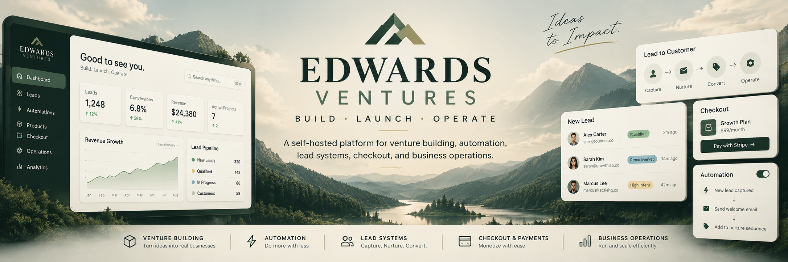

# Edwards Ventures (working name)

A **prototype venture-studio website** and portfolio for independently developed business software. This is a software artifact, not proof of an incorporated company or paying customers.

## Current projects
- [FlowForge AI](https://github.com/cuzzaintit321/flowforge-ai-business): AI-assisted business workflow prototype.
- [Edwards Technology & Operations](https://github.com/cuzzaintit321/edwards-technology-operations): Technology consulting and operations web prototype.

## Run locally

```bash
docker compose up -d --build
```

From a browser on the host use an SSH tunnel to the Docker host if remote:

```bash
ssh -N -L 8140:127.0.0.1:8140 yeet
```

Browse http://localhost:8140. Health endpoint: `/health`. Public deployment requires HTTPS, domain setup, security review, and appropriate business/legal planning.

## Goal
Validate one paid service pilot before investing in more product development. See `docs/VALIDATION_PLAN.md` and `docs/BUSINESS_ROADMAP.md`.
